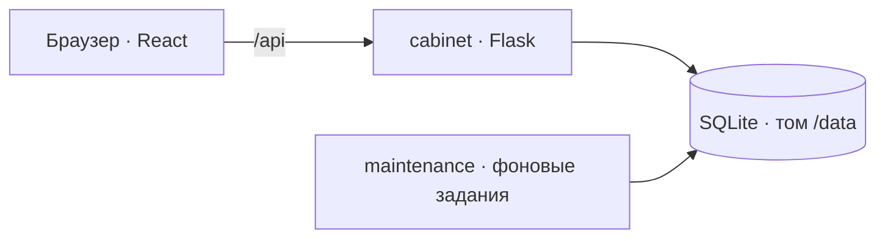

# Бюро — пример личного кабинета малого бизнеса

Учебный проект: один владелец входит в свой кабинет, выбирает цели бизнеса, ведёт клиентов и задачи, а затем может перейти с пробного тарифа на платный. Стек: React, Flask и один файл SQLite. Демо можно пройти от начала до конца без регистрации у провайдеров.

**С настоящим сервисом автор проверил только авторизацию через Яндекс ID.** Для SMS.RU, Госуслуг через шлюз ЕСИА и ЮKassa есть код и автоматические тесты с подменой ответов, но не было проверки реального входа, доставки SMS или оплаты у этих провайдеров. [Статус каждого сценария и инструкции](docs/integrations.md).

## Запустить демо

Из корня репозитория, с Docker Engine и Docker Compose **v2.24+**:

```sh
docker compose up --build -d --wait
```

Откройте **http://localhost:8080**. Файл `.env`, ключи и карта не нужны. При первой сборке скачиваются зависимости; готовое демо не обращается к внешним сервисам. По умолчанию порт доступен только на вашем компьютере.

| Что попробовать | Что вы увидите |
|---|---|
| Открыть «Обзор» | Своя песочница с 12 вымышленными клиентами и четырьмя задачами, не общая база посетителей |
| Нажать «Войти» или открыть [`/login`](http://localhost:8080/login) | Имитация Яндекс ID и Госуслуг. Для телефона используйте **+7 900 000-00-00**: код появится на экране, SMS не уйдёт |
| Выбрать цели в «Быстром старте» | В списке появятся подходящие задачи. Повторный выбор цели не создаст дубликаты |
| Добавить клиента, найти его поиском и обновить страницу | Карточка сохранится в SQLite. В демо используйте только вымышленные имена и контакты |
| Подключить «Бизнес» | Пробный тариф сменится на платный, откроется экспорт CSV. **В демо деньги не списываются** |

Проверка: `curl -fsS http://localhost:8080/healthz`. Остановка: `docker compose down`. Именованный том сохраняет данные между запусками; не добавляйте `-v`, если они нужны. Порт можно изменить переменной `PORT`.

## Как устроен пример



У сайта и `/api` один адрес. Оба сервиса Compose собираются из одного образа. `maintenance` очищает просроченные записи раз в сутки и сверяет незавершённые заказы каждые две минуты. Отдельные сервер БД и планировщик не требуются.

**Один запрос от формы до базы.** В [форме клиента](frontend/src/Dialogs.jsx) кнопка «Добавить клиента» вызывает [общий HTTP-клиент](frontend/src/api.js), который отправляет `POST /api/clients`. Обработчик [`save_client`](app/workspace.py) получает владельца из серверной сессии, проверяет право записи и лимит тарифа, записывает карточку и событие в одной транзакции. Браузер получает обновлённое состояние кабинета. Для собственной сущности этот путь можно использовать как образец; `account_id` не нужно принимать от браузера.

| Что хотите изменить | С какого файла начать |
|---|---|
| Способы входа | [`app/auth.py`](app/auth.py) — вход и подтверждение личности; [`available_integrations` в `app/core.py`](app/core.py) — какие кнопки доступны по настройкам |
| Цели, задачи и карточки клиентов | [`app/workspace.py`](app/workspace.py) — операции только в своём кабинете; [`app/schema.sql`](app/schema.sql) — таблицы и связи |
| Переход на платный тариф | [`app/billing.py`](app/billing.py) — заказ, проверка статуса у провайдера, выдача доступа |
| Проверить своё изменение | [`tests/`](tests/) — изоляция данных и правила API; [`frontend/e2e/`](frontend/e2e/) — путь пользователя в браузере |

## Если нужен настоящий вход

`APP_MODE=demo` — это способ работы стенда, **не тариф**. В `production` нет вымышленных клиентов и обхода входа. Новый подтверждённый пользователь тоже получает 14 пробных дней. «Бизнес» в примере стоит 990 ₽ за 30 дней без автопродления; после истечения срока остаётся чтение.

1. Скопируйте [`.env.example`](.env.example) в `.env` и ограничьте права (`chmod 600 .env`). Для первого реального теста достаточно **Яндекс ID**. Нужны свой HTTPS-домен в `PUBLIC_URL`, `APP_SECRET`, `YANDEX_CLIENT_ID`, `YANDEX_CLIENT_SECRET` и отдельный том. Не используйте демо-БД или публичное превью для реальных пользователей.
2. Проверьте доступные без входа [политику](http://localhost:8080/legal/policy) и [отдельное согласие](http://localhost:8080/legal/consent). Встроенные тексты — для теста входа через Яндекс ID физлицом Иваном Пупкиным. Ссылки `POLICY_URL`, `CONSENT_URL` и версия `test-login-v1` уже заданы в примере. Для реальных аккаунтов заполните почту оператора `OPERATOR_CONTACT` и хостинг с местом хранения базы и копий `OPERATOR_HOSTING` **только в своей конфигурации**. При изменении условий сохраните старый текст и обновите `CONSENT_VERSION`.
3. Установите `APP_MODE=production` и выполните [шаги подключения Яндекс ID](docs/integrations.md). SMS, ЕСИА и платежи необязательны: без ключей они выключены. Для реальной CRM, других способов входа или платежей нужны свои документы, основания обработки и приёмка у соответствующего провайдера.

Подробные руководства доступны также в «Центре помощи» кабинета:

- [Вход и оплата](docs/integrations.md) — настройки, callbacks и сценарии приёмки.
- [База и эксплуатация](docs/database.md) — схема, замеры на 1 000 и 10 000 аккаунтов, ограничения, резервирование и восстановление.
- [Персональные данные в РФ](docs/personal-data.md) — карта данных и обязанности оператора. Развёртывание примера не подтверждает соответствие законодательству.

## Разработка и проверки

Без Docker нужны Python 3.11, Node 22.12+ и npm:

```sh
python3 -m venv .venv
. .venv/bin/activate
pip install -r requirements.txt
(cd frontend && npm ci && npm run build)
python -m unittest discover -s tests -v
gunicorn --bind 0.0.0.0:8080 --workers 1 --threads 4 --no-control-socket wsgi:app
```

Настройки читаются из окружения процесса: вне Compose `.env` не загружается автоматически. Для разработки UI можно отдельно запустить `npm run dev` в `frontend/`; Vite проксирует API и документы на backend. Фоновый сервис запускается командой `python -m app.maintenance` с тем же окружением.

- **Браузерные тесты:** при запущенном локальном **демо** выполните `cd frontend && npx playwright install chromium && npm run test:e2e`. Они проходят вход, согласие, онбординг, тариф и мобильную навигацию без реальных провайдеров.
- **Нагрузка:** `python scripts/benchmark.py --accounts 10000 --concurrency 12 --requests 1200`. База и данные синтетические; это замер приложения, не провайдеров.

### Перед публикацией своей копии

Не коммитьте `.env`, ключи, SQLite-файлы или резервные копии. Для примеров адресов используйте зарезервированный домен `.test`. Для будущих коммитов в GitHub → **Settings → Emails** включите приватность и блокировку push с личной почтой; в локальном `git config user.email` укажите свой GitHub `noreply`.

Чтобы проверить конкретный адрес без передачи кому-либо, в полном клоне выполните `git fetch --all --tags`, затем `python3 scripts/check_email_history.py`. Введите адрес в скрытом запросе **локального терминала**, а не аргументом команды. Скрипт ищет буквальное совпадение без учёта регистра в объектах всех локально доступных веток и тегов, включая старые версии файлов, сообщения и поля автора/коммитера. Он выводит только идентификаторы совпавших объектов и ничего не переписывает. Копии у других людей, кэши, обсуждения на GitHub и недоступные локально ссылки PR в этот поиск не входят.
